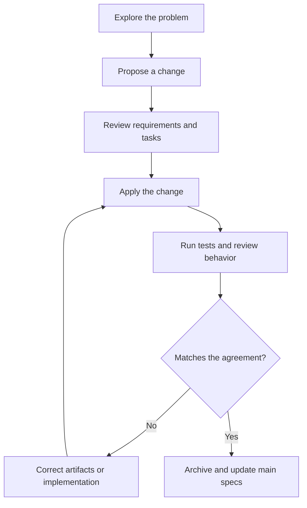

# OpenSpec

OpenSpec is an open-source toolkit from Fission AI for **spec-driven development with AI coding assistants**. It helps you agree on a change before an agent implements it, keep that agreement in reviewable files, and update your system's specifications when the change is finished.

It is not a model, coding assistant, or hosted application builder. You keep using an agent such as GitHub Copilot, Claude Code, or Codex. OpenSpec adds a CLI, agent skills, and a convention for organizing requirements, design decisions, and implementation tasks.

## The Problem It Solves

A prompt such as "add CSV export" leaves many decisions unstated. Which records? Which columns? Can a user export another team's data? What happens when there are no results?

Without a durable agreement, the agent can implement plausible behavior that is not the behavior you intended. A long chat is also difficult for another developer or a fresh agent session to pick up.

OpenSpec moves that agreement into Markdown files that you can inspect, correct, version, and review alongside code. The key distinction is between **the current system specification** and **a proposed change to it**.

## What It Is Used For

- Adding a bounded feature to an existing application without losing compatibility requirements.
- Agreeing on behavior and scope before implementation starts.
- Resuming work in a new agent session using files rather than chat history.
- Tracking several independent changes, each with its own proposal and tasks.
- Maintaining a capability-oriented description of the system as changes ship.

It also works for new projects. Start with one behavior rather than trying to specify the entire future application. For a trivial edit, a direct request plus a focused test may be enough; the artifacts are most valuable when there are decisions worth reviewing.

## The Files and Their Roles

An illustrative change folder looks like this:

```text
openspec/
  specs/
    order-export/
      spec.md
  changes/
    add-order-csv-export/
      proposal.md
      specs/
        order-export/
          spec.md
      design.md
      tasks.md
```

| Artifact | Question it answers |
| --- | --- |
| `openspec/specs/` | What behavior does the system currently promise? |
| `proposal.md` | Why make this change, what is in scope, and what is affected? |
| Change-local `specs/` | Which requirements are being added, modified, or removed? |
| `design.md` | How will the change work technically, and why this approach? |
| `tasks.md` | What implementation and verification work remains? |

The change-local specifications are **delta specs**, not a second unrelated description of the whole application. The default spec-driven workflow uses `ADDED`, `MODIFIED`, and `REMOVED` requirement sections. A modified requirement should contain its complete updated text, not just an instruction such as "also include the total."

Some changes do not need a separate design document. The selected schema determines the artifact requirements. If export is a new capability, its main spec may not exist until the change is archived.

## The Process



1. **Explore:** Ask the agent to investigate the code and discuss options. This is a thinking step, not permission to implement.
2. **Propose:** Generate a scoped proposal, behavioral requirements, any needed design, and tasks. No application code yet.
3. **Review:** Read and correct the artifacts. Requirements deserve particular attention: are these actually the conditions under which you would accept the feature?
4. **Apply:** Have the agent implement the named change, reading its artifacts and updating the task checkboxes. A fresh chat can resume from those files.
5. **Verify:** Run the repository's real checks and inspect the behavior against the requirements. Correct the artifacts if a decision changes.
6. **Archive:** Reconcile the delta into the main specs and move the completed change under `openspec/changes/archive/`.

These are an iterative loop, not irreversible phase gates. You can revise a requirement after discovering an implementation constraint. Review that revision explicitly instead of quietly weakening the requirement to match the code.

Archiving is a documentation operation, not a deployment, Git commit, or proof that tests passed.

## Setup and Command Syntax

The examples below follow the **OpenSpec 2.x** workflow documented on **November 16, 2026**. Older tutorials use `/opsx:*` commands; OpenSpec 2.0 removed those commands in favor of skills. Follow the syntax printed by your installed version and selected tool.

In a terminal, install the CLI and initialize it from your project directory. This npm installation requires Node.js **22.12.0 or newer**:

```bash
npm install -g @fission-ai/openspec@latest
cd your-project
openspec init
```

Initialization installs the project scaffolding and agent skills; it does not implement a feature. Review the generated files. Standalone and Homebrew installation options are available in the official documentation.

The following are **agent-chat invocations**, not shell commands. Most supported tools use slash skills; Codex uses a dollar-prefixed form. Plain-language requests also work when the agent can discover the installed skills.

## Concrete Example: CSV Export for Orders

Assume an existing authenticated orders application. Add an export for the **entire filtered result set**, not just the current page. Export only records the signed-in user is authorized to see.

### 1. Explore and Propose

Run these separately in your coding assistant's chat, reviewing each response:

```text
/openspec-explore
```

```text
Explore adding CSV export to our orders page. Inspect the existing filters,
authorization, pagination, and test conventions. Do not implement yet.
```

After deciding the scope:

```text
/openspec-propose add-order-csv-export
```

```text
The export must include all orders matching the current filters that the
signed-in user may access, across all pages. Columns: order_id, created_at,
status, total, currency. Preserve the existing JSON API. No results means a
header-only CSV. Handle CSV quoting and spreadsheet-formula injection safely.
```

The expected outcome is a reviewable change folder, not a working endpoint. Correct the generated artifacts before applying.

### 2. Review a Testable Requirement

An illustrative excerpt of `openspec/changes/add-order-csv-export/specs/order-export/spec.md`:

```markdown
## ADDED Requirements

### Requirement: Export authorized filtered orders
The system SHALL export all orders matching the requested filters that the
signed-in user is authorized to access, regardless of UI pagination.

#### Scenario: Another customer's order matches the filter
- **GIVEN** customer A and customer B both have paid orders
- **WHEN** customer A exports orders filtered by status paid
- **THEN** the CSV contains only customer A's matching orders

#### Scenario: Results span multiple pages
- **GIVEN** customer A has 75 matching orders and the UI page size is 25
- **WHEN** customer A exports those results
- **THEN** the CSV contains 75 data rows

#### Scenario: No matching orders
- **WHEN** an authorized user exports a filter with no matching orders
- **THEN** the CSV contains the agreed header and no data rows
```

This excerpt is not the whole spec. Add requirements for the exact columns, date and amount formats, escaping, formula safety, authentication failures, and any agreed export limits. "Valid CSV" alone does not settle those decisions.

### 3. Review the Design and Tasks

A reasonable design might reuse the existing authorization and filter logic, expose an export endpoint, and stream rows through an established CSV library. These are example decisions, not OpenSpec requirements.

The tasks should turn the requirements into concrete work:

```markdown
- [ ] Reuse the authorized order query without UI page limits.
- [ ] Generate the agreed columns with CSV escaping and formula safety.
- [ ] Add the authenticated export endpoint and download action.
- [ ] Test cross-customer isolation and multi-page exports.
- [ ] Test empty results, commas, quotes, newlines, and formula-like text.
- [ ] Confirm the existing JSON endpoint and filters still behave unchanged.
```

### 4. Apply, Verify, and Archive

In agent chat, select the named change if prompted:

```text
/openspec-apply-change add-order-csv-export
```

Review the implementation and run the actual unit, integration, and UI checks appropriate to the repository. For the sample data above, verify that the downloaded file has 75 data rows, none belonging to customer B. A checked task list does not establish that result.

Once the behavior and artifacts agree:

```text
/openspec-archive-change add-order-csv-export
```

After reconciliation, the accepted requirements live in `openspec/specs/order-export/spec.md`, and the change's proposal and task history live in the archive. Review the spec update as well as the code diff. The expanded profile also offers a verification skill, but it does not replace executable tests.

## OpenSpec vs. Spec Kit

Both tools put reviewable intent in files and rely on a separate coding agent to do the work. Neither makes generated code correct by definition, and both can be used in existing or new applications.

| Dimension | OpenSpec | GitHub Spec Kit's SDD process |
| --- | --- | --- |
| Organizing idea | A proposed change to system capabilities | A feature carried from specification through implementation |
| Typical artifacts | Proposal, delta specs, design, tasks | Project constitution, feature spec, plan, tasks |
| Completion mechanism | Archive and reconcile deltas into main specs | Converge against spec, plan, and tasks; implement remaining gaps |
| Useful emphasis | Evolving capability specs through small changes | Explicit project guardrails and a staged feature workflow |

Choose OpenSpec when its change-and-delta model matches how your team wants to maintain requirements. Choose [GitHub Spec Kit](spec-kit.md) when its constitution and feature-planning workflow better match your review process. "OpenSpec is only for existing apps" and "Spec Kit cannot iterate" are not reliable distinctions.

## Common Pitfalls

- **Approving vague specs:** Turn "secure export" into observable authorization and data-handling rules.
- **Treating generated artifacts as decisions:** The agent drafts; the team reviews and accepts the scope.
- **Skipping tests because tasks are checked:** Files record intent and progress, not independent evidence of correctness.
- **Archiving stale requirements:** Update the agreed specs when behavior changes during implementation.
- **Installing a workflow for every tiny edit:** Use enough structure to resolve real uncertainty, not to manufacture paperwork.

## Further Reading

- [OpenSpec repository](https://github.com/Fission-AI/OpenSpec)
- [Official quickstart](https://openspec.dev/docs/quickstart)
- [Installation](https://openspec.dev/docs/installation)
- [Upgrade to OpenSpec 2.0](https://openspec.dev/docs/upgrade-to-2)
- [Spec-driven schema and delta specs](https://openspec.dev/docs/schemas/spec-driven)
- [Agent Skills](skills.md)
- [GitHub Spec Kit](spec-kit.md)