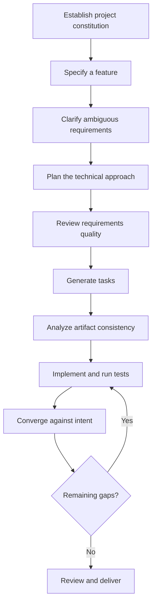

# GitHub Spec Kit

GitHub Spec Kit is an open-source toolkit for giving AI coding agents **structured development processes, reusable templates, and documented outcomes**. Its core spec-driven development (SDD) process turns a description of a feature into a specification, technical plan, implementation tasks, and code checked against that intent.

Spec Kit is not an AI model and is not GitHub Copilot itself. The **Specify CLI** initializes the workflow; your chosen coding agent reads the templates and artifacts, asks questions, and performs the work. You still review the requirements, design decisions, implementation, and test results.

## What It Is Used For

- Building a feature or a new application with an explicit agreement about behavior.
- Keeping business requirements separate from technical implementation choices.
- Applying shared project principles across agent-generated plans and code.
- Breaking a feature into reviewable, dependency-ordered tasks.
- Finding gaps between what was specified and what was actually implemented.
- Adding a bounded feature to an existing codebase while preserving its conventions and contracts.

Current Spec Kit also supports separate processes through extensions, including bug fixing and idea assessment, plus customization through presets, workflows, and bundles. Those are not mandatory steps in the SDD process explained here.

A small, obvious edit may not justify the full workflow. Spec Kit is useful when there are requirements, constraints, or coordination decisions that deserve a durable review trail.

## The Mental Model

| Layer | Question | Example |
| --- | --- | --- |
| Constitution | What principles govern this project? | Every customer-data feature needs an isolation test. |
| Specification | What must the feature do, and why? | Export all authorized orders matching the user's filters. |
| Plan | How will we build it in this repository? | Reuse the authorized query and stream CSV through the existing API. |
| Tasks | What concrete work must happen? | Add serialization, endpoint, download action, and tests. |
| Implementation and convergence | Does the code satisfy the agreed artifacts? | Check pagination, authorization, formatting, and compatibility. |

The **constitution** is a short set of project-wide principles, not a feature wishlist or a document generated once and forgotten. It should reflect standards the team actually accepts. An impractical rule such as "every change must achieve perfect coverage" creates friction rather than useful guidance.

The **specification** describes observable outcomes. Choose the framework, database approach, libraries, and module boundaries during planning, after the behavior is clear.

## The Process



| Step | Current Copilot skill | Result or responsibility |
| --- | --- | --- |
| Establish principles | `/speckit-constitution` | Capture project-wide guardrails, normally once up front. |
| Specify | `/speckit-specify` | Draft the feature's user scenarios, requirements, and success criteria. |
| Clarify | `/speckit-clarify` | Ask focused questions and incorporate the answers into the spec. |
| Plan | `/speckit-plan` | Produce the technical plan and supporting design artifacts. |
| Check requirements quality | `/speckit-checklist` | Generate a checklist for clarity, completeness, and consistency of requirements. |
| Generate tasks | `/speckit-tasks` | Create dependency-ordered implementation work. |
| Analyze | `/speckit-analyze` | Report inconsistencies and gaps across the spec, plan, and tasks. |
| Implement | `/speckit-implement` | Execute tasks using the repository's tools and test conventions. |
| Converge | `/speckit-converge` | Assess the code against intent and append tasks for remaining gaps. |

For a smaller feature, the documented shorter path after establishing the constitution is **specify → plan → tasks → implement → converge**. Clarification, requirements checklists, and analysis add useful review points when risk or ambiguity warrants them.

Run one skill at a time and inspect the result before continuing. Analysis is read-only: findings must be fixed in the relevant artifacts. A requirements checklist checks the quality of the agreement, not whether the application passes tests.

Convergence does not itself implement fixes. If it finds gaps, it appends remediation tasks; run implementation again and repeat convergence. Even a `Converged` report is an agent assessment, not a substitute for real tests, security review, or deployment validation.

## Setup and Version Notes

These examples follow the official **Spec Kit 1.4-era** documentation checked on **November 16, 2026**, using **GitHub Copilot's default skills integration**. Older guides commonly show dotted commands such as `/speckit.specify` and the older `--ai` setup flag. Invocation syntax depends on the version, integration, and mode; use what your installation provides.

The current setup requires Python **3.11 or newer**, `uv`, and a supported coding agent. In a terminal, create a new project:

```bash
uv tool install specify-cli
specify init order-portal --integration copilot
cd order-portal
```

For an existing repository, first establish a reviewable baseline, then initialize from its root:

```bash
specify init --here --force --integration copilot
```

`--force` permits initialization in a non-empty directory and may replace files at conflicting managed paths. Review those paths and the resulting diff before continuing. Initialization adds workflow files; it does not infer a complete specification from existing code or rewrite the application.

The `/speckit-*` invocations below belong in **your coding assistant's chat**, not in a shell.

## Concrete Example: CSV Export for Orders

Use the same feature as the [OpenSpec example](openspec.md): add CSV export to an existing authenticated orders application. Export the entire authorized filtered result set, not just the visible page, without changing the existing JSON API.

### 1. Establish Project Principles

If the project does not already have an agreed constitution:

```text
/speckit-constitution Preserve public API compatibility. Reuse existing
architecture and dependencies where suitable. Every customer-data feature
must include an automated cross-customer isolation test. Changes must pass
the repository's established unit and integration checks.
```

Review the resulting `.specify/memory/constitution.md`. These rules apply to later features too; do not make CSV-specific columns project-wide principles.

### 2. Specify Behavior and Resolve Ambiguity

```text
/speckit-specify Add CSV export to the orders page. A signed-in user can
download all orders matching the current filters that they are authorized
to access, across all pages. Columns: order_id, created_at, status, total,
currency. Preserve the JSON API. Empty results produce a header-only CSV.
Handle quoting and spreadsheet-formula injection safely.
```

Next:

```text
/speckit-clarify Focus on authorization, filtered results versus current-page
results, timestamp and amount formats, formula-like values, and export limits.
```

Answer with actual product decisions. For this example, assume UTC timestamps, decimal totals with a separate currency column, and export of all matching rows rather than UI page limits. Decide any size limits explicitly rather than letting an agent invent silent truncation.

An illustrative excerpt of the reviewed feature specification:

```markdown
## User Story 1: Download filtered orders
As a customer, I want to export my filtered orders so that I can reconcile them.

## Functional Requirements
- FR-001: The export MUST include only orders authorized for the signed-in user.
- FR-002: The export MUST apply the same filters as the orders page.
- FR-003: UI pagination MUST NOT limit the exported result set.
- FR-004: An empty result MUST produce the agreed header and no data rows.

## Acceptance Scenarios
1. Given customer A and customer B have paid orders, when A exports paid orders,
   then no order belonging to B appears in the CSV.
2. Given A has 75 matches and the UI page size is 25, when A exports,
   then the CSV contains 75 data rows.
3. Given no matches, when A exports, then only the header is downloaded.
```

This is an excerpt, not a complete generated template. The full spec must also settle the agreed column formats, CSV escaping, formula safety, unauthenticated behavior, and limits.

### 3. Plan the Technical Approach

```text
/speckit-plan Reuse the existing backend, authentication, authorized order
query, and filter parsing. Add a streaming CSV response using a maintained
CSV library compatible with our stack. Add a download action to the existing
orders page. Reuse the repository's test framework and preserve the JSON API.
```

The plan should explain how authorization remains enforced, how the export avoids UI pagination, and how the response handles encoding, headers, escaping, and formula-like content. Streaming is an example design choice, not a guarantee of unlimited export capacity.

Typical artifacts might include:

```text
.specify/
  memory/
    constitution.md
  feature.json
specs/
  001-order-csv-export/
    spec.md
    plan.md
    research.md
    data-model.md
    contracts/
    quickstart.md
    checklists/
    tasks.md
```

Names and supporting files depend on the templates and feature. The constitution governs the project; the `specs/` directory holds feature artifacts. The current workflow records the active feature directory in `.specify/feature.json`, with an environment-variable override. Do not assume switching Git branches selects a feature. Git integration is optional.

### 4. Review Quality and Generate Tasks

Run each separately:

```text
/speckit-checklist
```

Review whether the requirements are complete and unambiguous. Mark custom checklist items satisfied only when a reviewer has actually checked them. Then generate the implementation work:

```text
/speckit-tasks
```

The resulting `tasks.md` should include the authorized query, serializer, endpoint, UI action, and tests traceable to the requirements. For example, FR-001 needs a cross-customer isolation test, and FR-003 needs a result set larger than one page.

```text
/speckit-analyze
```

If the analysis finds that FR-003 has no implementation task, fix the task coverage before coding. If the spec and plan disagree on columns or scope, resolve that disagreement at its source.

### 5. Implement, Test, and Converge

```text
/speckit-implement
```

Inspect the code and run the repository's actual checks. For this feature, verification should cover cross-customer isolation, 75 matches across 25-row pages, empty output, commas, quotes, newlines, formula-like values, and compatibility of the existing JSON endpoint.

Then:

```text
/speckit-converge
```

Suppose the download works but still uses a 25-row page limit. Convergence should identify the mismatch with FR-003 and add a task to remove that limitation. Run `/speckit-implement` again, rerun the affected tests, and converge again.

Completion means the agreed behavior is implemented, the checks provide evidence, the artifacts reflect the accepted decisions, and human review is satisfied. It does not mean the feature has automatically been committed, deployed, or approved.

## Spec Kit vs. OpenSpec

Both tools support iteration and work with existing applications. The useful distinction is how you want to organize and maintain intent, not which tool can generate code.

| Prefer this emphasis | Consider |
| --- | --- |
| Project-wide principles followed by feature specs, plans, tasks, and consistency checks | Spec Kit's SDD process |
| Change proposals and deltas reconciled into capability specs when archived | [OpenSpec](openspec.md) |
| Additional structured processes such as bug assessment or idea evaluation | Spec Kit's optional extensions |
| A very small change with little ambiguity | Your existing agent workflow and focused tests may be sufficient |

Spec Kit's convergence step checks implementation against the feature artifacts. It is not OpenSpec's delta-reconciliation/archive operation. Decide how completed Spec Kit feature artifacts will be retained and updated as the application evolves; accumulating untouched old specs does not automatically produce a trustworthy system specification.

## Common Pitfalls

- **Writing implementation detail into the first specification:** Start with user outcomes; put technical choices in the plan.
- **Accepting an invented constitution:** Use rules the team can explain and intends to enforce.
- **Running every skill without reviewing the output:** A longer workflow cannot repair an unexamined requirement.
- **Confusing checklist completion with software verification:** Requirements quality, task completion, and passing tests are different claims.
- **Treating convergence as a test suite:** Use the report to find gaps, then verify fixes with executable checks.
- **Forgetting existing behavior:** State compatibility boundaries and make the plan reuse the real codebase.

## Further Reading

- [Spec Kit repository](https://github.com/github/spec-kit)
- [Official SDD quickstart](https://github.github.io/spec-kit/quickstart.html)
- [Installation](https://github.github.io/spec-kit/installation.html)
- [Adopting Spec Kit in an existing project](https://github.github.io/spec-kit/how-to/existing-projects.html)
- [Command invocation across integrations](https://github.github.io/spec-kit/integrations/cli.html#command-invocation)
- [Evolving specifications](https://github.github.io/spec-kit/how-to/evolving-specs.html)
- [OpenSpec](openspec.md)