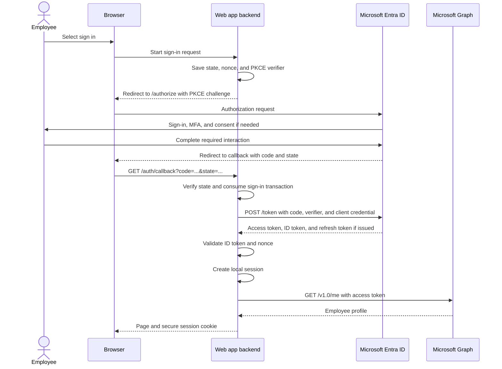

# OAuth 2.0 Flow with Azure (Microsoft Entra ID)

For the provider-independent idea, industry-standard status, and shared security model, start with [OAuth 2.0: Delegated API Authorization](oauth2.md). This article applies that framework to Microsoft Entra ID; [OAuth 2.0 with Google](oauth2-with-google.md) provides another implementation and highlights provider differences.

OAuth 2.0 lets an application access an API with permission, without receiving the user's password. Microsoft Entra ID, formerly Azure Active Directory (Azure AD), implements OAuth 2.0 through the Microsoft identity platform.

This guide follows a server-side web application that signs in an employee and reads their Microsoft Graph profile. It uses **authorization code flow with PKCE**, plus OpenID Connect for sign-in, and the Microsoft public cloud's v2.0 endpoints.

## Authorization Is Not Authentication

- **OAuth 2.0** answers: "What may this application access?" An access token lets the application call an API.
- **OpenID Connect (OIDC)** adds: "Who signed in?" It builds on OAuth 2.0 and supplies an ID token when the application requests the `openid` scope.

"Sign in with Microsoft" commonly combines both. An ID token is for the application; it is not a substitute for an access token when calling an API.

## The Participants

| OAuth role | In this example | Responsibility |
| --- | --- | --- |
| Resource owner | The employee | Authorizes access, subject to organizational policy. |
| Client | Your web application | Requests permission and calls Graph on the employee's behalf. |
| Authorization server | Microsoft Entra ID | Authenticates the employee, evaluates consent and policy, and issues tokens. |
| Resource server | Microsoft Graph | Validates the access token and enforces API permissions. |
| Browser | The employee's browser | Carries redirects between your application and Entra ID. |

The **client** is your application, not the employee. The browser participates in the flow, but this example's backend handles the token exchange and stores the tokens.

## Register the Application

In the Microsoft Entra admin center, go to **App registrations** and create an application:

1. Select accounts in your organizational directory only for this single-tenant example.
2. Record the **Directory (tenant) ID** and **Application (client) ID**. These identifiers are not secrets.
3. Configure a **Web** redirect URI, such as `https://localhost:5001/auth/callback`. The application must actually serve this callback and have local HTTPS configured.
4. Add the Microsoft Graph **delegated** permission `User.Read` under API permissions. Consent may require an administrator depending on tenant policy.
5. Configure a server-side credential. The protocol example below uses a client secret for readability; prefer certificates or supported federated credentials for production deployments.

The tenant is the organization's identity directory, not an Azure subscription. An app registration identifies and configures the application; it does not host your application code.

Use the secret's **value**, not its credential ID, and keep it in server-side secret storage. Never put it in JavaScript delivered to a browser, a URL, source control, or logs.

## The Complete Flow



The browser carries a short-lived, single-use **authorization code**, not the access token, in this flow. The backend exchanges that code directly with Entra ID over HTTPS.

### 1. Prepare a Sign-In Transaction

Before redirecting the browser, the backend generates and saves:

- `state`: A cryptographically random value tied to this browser's sign-in transaction. Checking it on return helps prevent login CSRF and response mix-ups.
- `nonce`: A fresh random value that must match the validated ID token's `nonce` claim, binding that token to this sign-in request.
- `code_verifier`: A cryptographically random PKCE value, 43-128 characters long, using the allowed unreserved characters.

Derive the public PKCE challenge from the verifier:

```text
code_challenge = BASE64URL(SHA256(ASCII(code_verifier)))
```

Base64url encoding here omits `=` padding. Send the challenge to Entra ID, but keep the verifier for the token exchange. Do not reuse these values between sign-in attempts. Use a maintained authentication library to generate and manage them.

### 2. Redirect to Entra ID

The backend sends the browser to the authorization endpoint. This URL is shown across lines for readability; construct a single URL using a URL/query builder and URL-encode its parameter values:

```text
https://login.microsoftonline.com/{tenant-id}/oauth2/v2.0/authorize
  ?client_id={client-id}
  &response_type=code
  &redirect_uri=https%3A%2F%2Flocalhost%3A5001%2Fauth%2Fcallback
  &response_mode=query
  &scope=openid%20profile%20offline_access%20https%3A%2F%2Fgraph.microsoft.com%2FUser.Read
  &state={random-state}
  &nonce={random-nonce}
  &code_challenge={derived-challenge}
  &code_challenge_method=S256
```

The scopes request different things:

| Scope | Purpose |
| --- | --- |
| `openid` | Requests OIDC sign-in and an ID token. |
| `profile` | Requests standard profile claims in the OIDC identity information; it does not grant Graph access. |
| `offline_access` | Requests a refresh token for obtaining later access tokens without another interactive sign-in, subject to policy. |
| `https://graph.microsoft.com/User.Read` | Requests delegated access to the signed-in user's Graph profile. |

Entra ID handles the password, MFA, Conditional Access, and consent. Existing sessions or prior consent can eliminate some prompts. Requesting a scope is not a guarantee that it will be granted.

### 3. Handle the Callback

On success, Entra ID redirects the browser to the registered callback:

```text
https://localhost:5001/auth/callback?code={authorization-code}&state={returned-state}
```

The backend must match `state` to the stored, browser-bound transaction and reject missing, mismatched, expired, or already-consumed transactions. It must also handle error responses, such as `error=access_denied`, instead of assuming every callback contains a code.

The redirect URI must match the registered value and be the same value used in the token exchange. Avoid logging callback query strings because they contain authorization codes.

### 4. Exchange the Code for Tokens

The backend sends a form-encoded HTTPS POST to Entra ID. This is a **server-to-server request**, not a browser redirect:

```http
POST /{tenant-id}/oauth2/v2.0/token HTTP/1.1
Host: login.microsoftonline.com
Content-Type: application/x-www-form-urlencoded

client_id={client-id}&grant_type=authorization_code&code={authorization-code}&redirect_uri=https%3A%2F%2Flocalhost%3A5001%2Fauth%2Fcallback&code_verifier={original-verifier}&client_secret={url-encoded-secret-value}
```

All form values must be encoded using a form encoder. The placeholders are illustrative, not working credentials.

Entra ID checks the code, client, redirect URI, client credential, and PKCE verifier. The verifier must produce the challenge sent in step 2. An intercepted code alone is therefore insufficient to complete the PKCE exchange. PKCE does not replace client authentication for a confidential client.

An illustrative successful response looks like this:

```json
{
  "token_type": "Bearer",
  "scope": "User.Read",
  "expires_in": 3599,
  "access_token": "<access-token>",
  "id_token": "<id-token>",
  "refresh_token": "<refresh-token>"
}
```

The actual lifetime and returned fields depend on the request and policy. Do not hard-code the example lifetime or assume refresh tokens are always available.

### 5. Establish the Application Session

Before trusting the ID token, use an OIDC library to validate its signature using Entra's published keys, issuer, audience (your client ID), lifetime, and the saved nonce. Obtain metadata and signing keys through the tenant's discovery document:

```text
https://login.microsoftonline.com/{tenant-id}/v2.0/.well-known/openid-configuration
```

Decoding a JWT is not validation. Libraries also handle metadata caching and signing-key rotation.

The backend then creates its own application session, typically represented by a `Secure`, `HttpOnly` cookie with an appropriate `SameSite` policy. Store tokens in a protected server-side cache; do not place them inside a readable browser cookie. Protect state-changing application requests against CSRF as well.

An Entra sign-in session, your application's session, and an API access token have separate lifetimes. Your application still decides which local features or data the employee may access.

### 6. Call Microsoft Graph

The backend attaches the **access token**, not the ID token, to the API request:

```http
GET /v1.0/me HTTP/1.1
Host: graph.microsoft.com
Authorization: Bearer <access-token>
```

Graph validates the token and checks the granted permissions. A bearer token can be used by whoever possesses it, so do not log it or expose it to unrelated services.

This access token is for **Microsoft Graph**. Do not send it to your own API as proof of authorization. An access token for your own API must target that API's audience and permissions. Treat Graph tokens as opaque; their format is not a contract for your application to parse.

### 7. Renew Access When Needed

Use the authentication library's token cache and silent token-acquisition API. When necessary, the library can redeem a refresh token at the token endpoint using `grant_type=refresh_token`, the refresh token, client ID, and confidential-client authentication.

Keep refresh tokens protected, replace the cached value when Entra returns a new one, and handle revocation or interaction-required responses by starting an interactive flow. `offline_access` does not mean permanent access or bypass organizational policy.

## What Each Value Is For

| Value | Intended use | Important distinction |
| --- | --- | --- |
| Client ID | Identifies the application | Public identifier, not a password. |
| Client secret or other credential | Authenticates a confidential client | Server-side only; does not identify the employee. |
| Authorization code | Redeemed once at the token endpoint | Not usable as a Graph bearer token. |
| PKCE verifier | Binds code redemption to the initiating transaction | Not a long-lived application credential. |
| ID token | Lets the client establish the user's identity | Audience is the client; not an API access token. |
| Access token | Authorizes calls to the target API | Audience is the resource API, not necessarily your app. |
| Refresh token | Obtains new access tokens from Entra ID | Not sent to Graph or other resource APIs. |
| Application session cookie | Connects browser requests to your app's session | Separate from Entra tokens and Entra's own cookies. |

## Other Application Types

| Situation | Appropriate flow | Key difference |
| --- | --- | --- |
| Server-side web app with a user | Authorization code with PKCE | Backend authenticates as a confidential client and keeps tokens server-side. |
| SPA or native application | Authorization code with PKCE | Public client: no embedded client secret. Register the appropriate platform and redirect URI; use MSAL for that platform. |
| Background service with no user | Client credentials | Uses application permissions and `https://graph.microsoft.com/.default` for Graph; no user, ID token, or refresh token. Graph `/me` is not available without a signed-in user. |
| API calling another API for a user | On-behalf-of | Exchanges a user access token intended for the middle-tier API for a downstream token. Do not simply forward a Graph token or ID token. |

**Delegated permissions** apply when acting on behalf of a signed-in user. **Application permissions** apply when the service acts as itself and require administrator consent. They are not interchangeable. On Azure, managed identities can remove the need to manage application secrets for supported service-to-service scenarios.

Do not start a new application with the implicit flow or a flow that collects the user's password directly (Resource Owner Password Credentials). Use Microsoft's maintained MSAL libraries, or an established framework OIDC integration, rather than hand-writing this protocol.

## Common Failures

| Symptom | Check |
| --- | --- |
| Redirect URI mismatch (`AADSTS50011`) | Registered platform and URI, including scheme, host, path, and case-sensitive path matching. |
| `invalid_client` | Client ID, tenant, expired credential, secret value versus secret ID, and form encoding. |
| `invalid_grant` during code exchange | Reused or expired code, wrong verifier, or inconsistent redirect URI. |
| Consent or administrator approval required | Requested delegated permissions and tenant consent policy. |
| API returns `401` | Missing, expired, or otherwise invalid access token, including wrong audience. |
| API returns `403` | Insufficient permissions, missing consent, resource restrictions, or other API policy; inspect the error body. |
| Sign-in succeeds but your API rejects the token | A Graph access token or an ID token may have been used instead of an access token for your API. |

Use correlation IDs and sanitized error details for diagnosis. Never paste passwords, secrets, authorization codes, or tokens into tickets or public token-decoding websites.

## References

- [Microsoft: OAuth 2.0 authorization code flow](https://learn.microsoft.com/en-us/entra/identity-platform/v2-oauth2-auth-code-flow)
- [Microsoft: OpenID Connect on the identity platform](https://learn.microsoft.com/en-us/entra/identity-platform/v2-protocols-oidc)
- [Microsoft: Permissions and consent](https://learn.microsoft.com/en-us/entra/identity-platform/permissions-consent-overview)
- [Microsoft: Access tokens](https://learn.microsoft.com/en-us/entra/identity-platform/access-tokens)
- [Microsoft: Client credentials flow](https://learn.microsoft.com/en-us/entra/identity-platform/v2-oauth2-client-creds-grant-flow)
- [Microsoft: Authentication libraries](https://learn.microsoft.com/en-us/entra/identity-platform/reference-v2-libraries)
- [RFC 7636: Proof Key for Code Exchange](https://www.rfc-editor.org/rfc/rfc7636)
- [RFC 9700: Best Current Practice for OAuth 2.0 Security](https://www.rfc-editor.org/rfc/rfc9700)