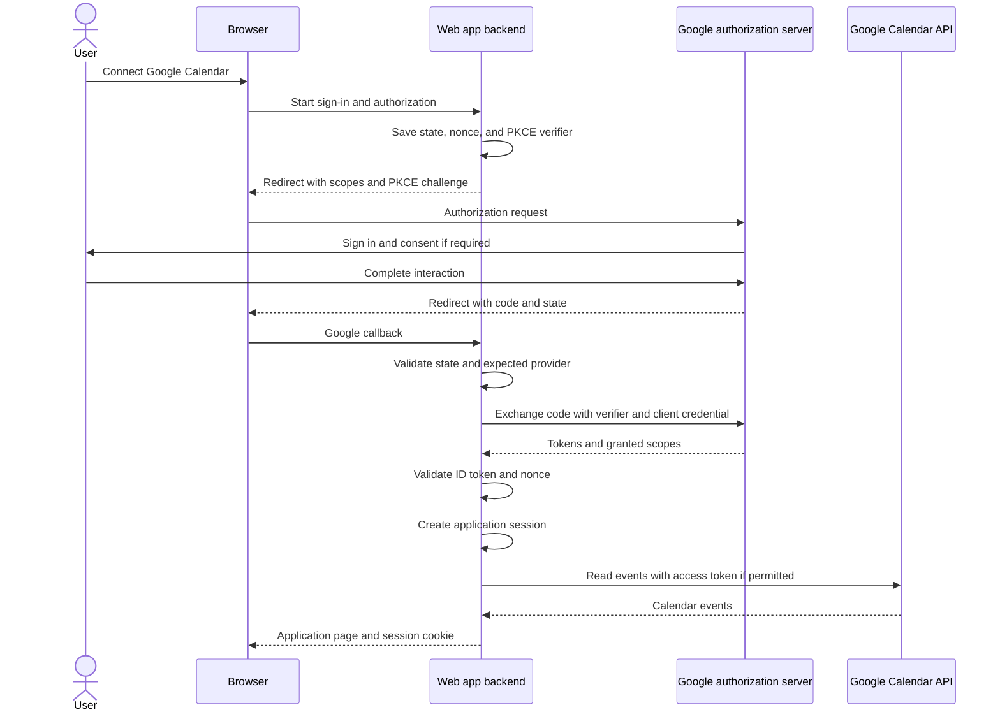

# OAuth 2.0 Flow with Google

Research checked: 2026-11-10

This example applies the shared [OAuth 2.0 authorization model](oauth2.md) to a server-side web application that signs in a Google user and reads their Google Calendar. It uses OpenID Connect (OIDC) for identity and an OAuth access token for Calendar API access, with authorization code flow and PKCE.

The protocol is the same family used by [Microsoft Entra ID](oauth2-with-azure.md), but registration, scopes, endpoints, and token policies differ. This is a protocol walkthrough, not a complete runnable application. Use a maintained Google-compatible OAuth/OIDC library that supports the client type and handles PKCE and token validation.

## The Participants

| Role | Google example |
| --- | --- |
| Resource owner | The person granting access to their calendar |
| Client | Your web application's backend |
| Authorization server / OIDC provider | Google's authorization and identity services |
| Resource server | Google Calendar API |
| Browser | Carries the user's interaction and authorization redirects |

Your application does not receive the user's Google password. In this backend design, it also does not expose Google access or refresh tokens to browser JavaScript.

## Register the Application

1. Select or create a Google Cloud project and enable the **Google Calendar API**.
2. Configure the **Google Auth Platform** branding, audience, and requested data-access scopes. Choose the audience that matches your intended users; an internal app is restricted to the applicable organization.
3. If using an external app in **Testing** with Calendar access, add the intended test users. Publishing and verification requirements depend on the audience and requested scopes; requesting sensitive or restricted scopes can require verification before public use.
4. Create an OAuth client with application type **Web application**. Register an authorized redirect URI, such as `https://localhost:5001/auth/google/callback`. The backend must actually serve this callback and have local HTTPS configured.
5. Store the client ID and client secret securely. The client ID is public; the secret or downloaded credentials file must remain on the backend, outside public assets, logs, and source control.

Registering a JavaScript origin is not the same as registering a redirect URI. Google requires the redirect URI to match the registered value, including scheme, case, path, port, and trailing slash where present. Google permits HTTP localhost redirects for development, but use HTTPS for deployed web applications.

## Discovery and Endpoints

Use the trusted discovery document to configure an OIDC library and obtain Google's current endpoints and signing-key location:

```text
https://accounts.google.com/.well-known/openid-configuration
```

At the research baseline, it publishes:

| Purpose | Endpoint |
| --- | --- |
| Issuer | `https://accounts.google.com` |
| Authorization | `https://accounts.google.com/o/oauth2/v2/auth` |
| Token exchange and refresh | `https://oauth2.googleapis.com/token` |
| OIDC UserInfo | `https://openidconnect.googleapis.com/v1/userinfo` |
| Token revocation | `https://oauth2.googleapis.com/revoke` |

The discovery document advertises `S256` PKCE support. Configure your library to generate the verifier/challenge and send the verifier during exchange; do not assume that every SDK helper enables PKCE automatically.

## The Complete Flow



### 1. Prepare the Transaction

Generate a fresh random `state`, OIDC `nonce`, and PKCE `code_verifier`. Store them in a short-lived, browser-bound backend transaction, together with the expected provider and callback URI.

Derive the challenge using `BASE64URL(SHA256(ASCII(code_verifier)))`, without Base64 padding. Keep the verifier private until the token exchange. See the [provider-neutral PKCE explanation](oauth2.md#why-pkce-exists) for what this protects.

### 2. Redirect to Google

This URL is wrapped for readability. Use a URL builder to produce one URL and encode each raw parameter value exactly once:

```text
https://accounts.google.com/o/oauth2/v2/auth
  ?client_id={client-id}
  &response_type=code
  &redirect_uri=https%3A%2F%2Flocalhost%3A5001%2Fauth%2Fgoogle%2Fcallback
  &scope=openid%20email%20profile%20https%3A%2F%2Fwww.googleapis.com%2Fauth%2Fcalendar.readonly
  &state={random-state}
  &nonce={random-nonce}
  &code_challenge={derived-challenge}
  &code_challenge_method=S256
  &access_type=offline
  &include_granted_scopes=true
```

| Parameter or scope | Meaning |
| --- | --- |
| `openid` | Requests OIDC sign-in and an ID token. |
| `email` and `profile` | Request identity claims; they do not grant Calendar access. |
| `https://www.googleapis.com/auth/calendar.readonly` | Requests read-only Calendar access. Choose a narrower Calendar scope if it meets your actual feature's needs. |
| `access_type=offline` | Requests refresh-token-based access when the user is not present. It is not a scope. |
| `include_granted_scopes=true` | Enables incremental authorization to include previously granted scopes in the combined authorization. It is not permission to assume every newly requested scope was granted. |

For teaching, this example combines sign-in and Calendar consent. In a product, request Calendar access when the user invokes a Calendar feature rather than making it a prerequisite for unrelated sign-in.

`prompt=consent` deliberately asks for consent again. Use it when re-consent is necessary, such as recovering a missing refresh token; do not force it on every normal sign-in.

### 3. Check the Callback

On success, Google redirects the browser to the application's registered URI, with a code and the original state, potentially alongside other response parameters:

```text
https://localhost:5001/auth/google/callback?code={authorization-code}&state={returned-state}
```

Match `state` to the stored browser-bound transaction and reject missing, mismatched, expired, or consumed transactions. Handle errors such as `access_denied` rather than assuming a code is present. Use the library's issuer/mix-up defenses, especially when supporting both Google and Microsoft.

Do not log callback query strings or render a callback page containing third-party scripts. Process the callback, then redirect to a clean application URL without the code.

### 4. Exchange the Code on the Backend

Send a form-encoded HTTPS POST. All placeholders below must be replaced with actual values through a form encoder, not string concatenation:

```http
POST /token HTTP/1.1
Host: oauth2.googleapis.com
Content-Type: application/x-www-form-urlencoded

client_id={client-id}&client_secret={encoded-client-secret}&code={encoded-authorization-code}&grant_type=authorization_code&redirect_uri=https%3A%2F%2Flocalhost%3A5001%2Fauth%2Fgoogle%2Fcallback&code_verifier={original-verifier}
```

The client credential authenticates this confidential web client. PKCE separately binds redemption to the initiating transaction; it does not replace client authentication. The redirect URI must be the same one used in the authorization request.

An illustrative successful response, when all requested permissions and a refresh token are granted, is:

```json
{
  "access_token": "<google-access-token>",
  "expires_in": 3599,
  "token_type": "Bearer",
  "scope": "openid email profile https://www.googleapis.com/auth/calendar.readonly",
  "id_token": "<google-id-token>",
  "refresh_token": "<google-refresh-token>"
}
```

Actual scope strings, lifetime, and fields can differ. Check the granted scopes through the library's credential metadata and disable features whose permissions were not granted. A successful sign-in alone is not proof of Calendar permission.

### 5. Validate Identity and Establish a Session

Use an OIDC library to validate the ID token's signature with Google's published keys, accepted Google issuer, audience (your client ID), lifetime, and the saved nonce. Google's documented issuer values are `https://accounts.google.com` or `accounts.google.com`; use the library's Google-compatible validation rather than accepting arbitrary issuers. Decoding the JWT without these checks is insufficient.

Identify the user using the validated Google `sub`, qualified by the provider/issuer in a multi-provider account model. Do not use email as the permanent account identifier or automatically merge accounts solely because their email strings match.

If restricting access to a Workspace domain, validate the ID token's `hd` claim against your allowed domains. The request's `hd` hint or an email suffix alone is not an authorization boundary.

Create your own application session, typically represented by a `Secure`, `HttpOnly` cookie with an appropriate `SameSite` policy. Keep Google tokens in protected server-side storage associated with the correct application user, and protect state-changing application requests against CSRF.

### 6. Call Google Calendar

If Calendar permission was granted, the backend sends the access token to the API:

```http
GET /calendar/v3/calendars/primary/events?maxResults=10 HTTP/1.1
Host: www.googleapis.com
Authorization: Bearer <google-access-token>
```

The example assumes the account has an available primary calendar. The API checks the token, granted permissions, and resource access. Follow `nextPageToken` when retrieving additional pages.

Do not send the ID token as the Calendar API bearer token. Do not send a Google Calendar access token to Microsoft Graph or your own API as proof of authorization. Treat Google's access tokens as opaque rather than assuming a JWT format.

## Refresh Tokens and Offline Access

Google normally returns a refresh token on the first offline authorization/code exchange, not every subsequent sign-in. Persist it securely and **do not overwrite an existing refresh token with an absent value** from a later response.

When needed, the backend can refresh access with a form-encoded request:

```http
POST /token HTTP/1.1
Host: oauth2.googleapis.com
Content-Type: application/x-www-form-urlencoded

client_id={client-id}&client_secret={encoded-client-secret}&grant_type=refresh_token&refresh_token={encoded-refresh-token}
```

Use the library's refresh support rather than reimplementing its cache and renewal behavior. Retain the existing refresh token unless a replacement is returned. Handle `invalid_grant` and revoked consent by requesting renewed authorization when appropriate; do not retry an invalid refresh token indefinitely.

For an **external** app with publishing status **Testing**, refresh tokens normally expire after **seven days**, unless the requested scopes are limited to basic identity scopes. This walkthrough requests Calendar access, so that exception does not apply. Published applications also need to handle expiry, revocation, inactivity, organization policy, and token-count limits; offline access is not permanent access.

## What Differs from Microsoft Entra ID?

| Concern | Google example | Microsoft example |
| --- | --- | --- |
| Registration | Google Cloud project and OAuth web client | Entra app registration and tenant |
| Authorization endpoint | Shared Google authorization endpoint | Tenant-qualified Microsoft endpoint in the single-tenant example |
| API permission | Google Calendar scope URL | Microsoft Graph `User.Read` scope |
| Request offline access | `access_type=offline` query parameter | `offline_access` scope |
| Call the API | Google access token to Google Calendar | Graph access token to Microsoft Graph |
| Background workloads without a user | Evaluate service accounts or workload identity for the target Google API | Evaluate managed identities or client credentials for the target API |

Google's service-account and workload-identity mechanisms are not a drop-in replacement of endpoint names in Microsoft's client-credentials example. A service account does not automatically have access to an arbitrary person's calendar; sharing or administrator-approved domain-wide delegation, where applicable, is a separate decision.

## Common Failures

| Symptom | Check |
| --- | --- |
| `redirect_uri_mismatch` | Exact registered URI and correct OAuth client type. |
| `invalid_client` | Client ID, server credential, and client configuration. |
| `invalid_grant` during exchange | Expired/reused code, wrong verifier, or inconsistent redirect URI. |
| `invalid_grant` during refresh | Revocation, expiry, test-mode lifetime, account policy, or token-count limits. |
| `access_denied` or `admin_policy_enforced` | User consent, test-user access, publishing/verification status, and Workspace administrator restrictions. |
| Calendar API `403` | Granted Calendar scope, API enablement, resource permissions, quota, and the API's error reason. |
| Sign-in works but no refresh token arrives | `access_type=offline`, previous authorization, and whether re-consent is actually needed. |

For a browser-only Google Identity Services integration, follow its own sign-in or authorization flow documentation. A sign-in button that returns an ID token is not automatically a grant for Calendar access, and browser code must never contain this backend client's secret.

## References and Scope

- [Google: OAuth 2.0 for Web Server Applications](https://developers.google.com/identity/protocols/oauth2/web-server)
- [Google: OpenID Connect](https://developers.google.com/identity/protocols/oauth2/openid-connect)
- [Google: OIDC discovery document](https://accounts.google.com/.well-known/openid-configuration)
- [Google: OAuth 2.0 and refresh-token expiration](https://developers.google.com/identity/protocols/oauth2)
- [Google: OAuth production readiness](https://developers.google.com/identity/protocols/oauth2/production-readiness/overview)
- [Google Calendar: List events](https://developers.google.com/workspace/calendar/api/v3/reference/events/list)
- [Google: Service accounts](https://developers.google.com/identity/protocols/oauth2/service-account)

Endpoints and provider behavior were checked against the linked documentation. The flow has not been executed against a registered Google client; examples intentionally contain placeholders rather than live credentials.
