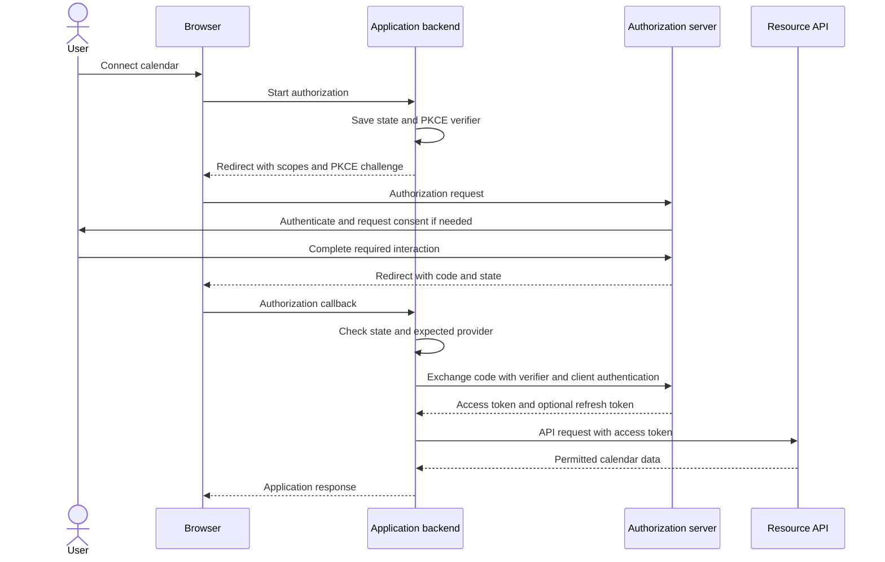

# OAuth 2.0: Delegated API Authorization

Research checked: 2026-11-10

OAuth 2.0 lets an application obtain limited access to an API without asking the user to give that application their password. Its central idea is **delegation**: the application receives a token representing permitted access, rather than the user's account credentials.

This guide explains the protocol independently of any vendor. For concrete implementations, see [OAuth 2.0 with Microsoft Entra ID](oauth2-with-azure.md) and [OAuth 2.0 with Google](oauth2-with-google.md).

## Is It the Industry Standard?

**Yes, for delegated API authorization, OAuth 2.0 is the de facto industry standard.** It is also formally specified by the IETF in RFC 6749, with extensions and updated security guidance. RFC 9700 describes its adoption as the standard for API protection and the basis for federated login using OpenID Connect. Microsoft and Google implement this shared framework; neither provider defines OAuth by itself.

That does not mean OAuth is the answer to every security problem:

| Need | Relevant mechanism |
| --- | --- |
| Let an application call an API on a user's behalf | OAuth 2.0 |
| Let an application establish who signed in | OpenID Connect (OIDC), commonly built on OAuth 2.0 |
| Enterprise browser-based single sign-on | OIDC or another federation protocol, such as SAML |
| Authenticate a person with a passkey or MFA | An authentication mechanism used during sign-in, not a replacement name for OAuth |
| Maintain a browser's session with your application | An application session, commonly represented by a cookie |
| Let one service call another without a user | Often an OAuth grant or workload identity mechanism supported by that environment |

API keys, session cookies, mutual TLS, and other mechanisms still have uses. "Industry standard" means broadly adopted for a particular purpose, not mandatory for every API.

## The Problem It Solves

Suppose a scheduling application needs to read your calendar. Giving it your account password would let it impersonate you broadly, create another place where your password could leak, and make selective revocation difficult.

Instead:

1. The application asks the calendar provider for a defined permission.
2. You authenticate directly with the provider and approve access when required.
3. The provider issues the application an access token.
4. The calendar API checks that token before returning permitted data.

The provider controls issuance, scope, lifetime, and revocation policy. Delegation can be approved by an administrator or existing policy rather than a new consent prompt every time. Revocation does not necessarily invalidate every already-issued access token immediately; enforcement depends on the token and deployment.

## The Four Roles

| Role | Meaning | Calendar example |
| --- | --- | --- |
| Resource owner | The entity able to authorize access | The person whose calendar is being accessed |
| Client | The application requesting access | The scheduling application |
| Authorization server | Authenticates as required, evaluates authorization, and issues tokens | The provider's authorization service |
| Resource server | Hosts the protected API and enforces access | The calendar API |

The client is the application, not the user. The browser carries interactions and redirects but is not a fifth OAuth role. Authorization and resource servers may be operated by the same organization without being the same endpoint.

## Authorization Code Flow with PKCE

For a user-facing application, authorization code flow with PKCE is the modern starting point. This diagram follows a **server-side web application**, whose backend keeps tokens out of browser JavaScript:

The authorization code is a short-lived, single-use intermediate credential, not an API access token. The code exchange lets the server bind token issuance to the registered client, redirect URI, and PKCE transaction. In this backend design, tokens return directly to the backend rather than through the callback URL.

### Why PKCE Exists

PKCE (Proof Key for Code Exchange) binds code redemption to the initiating transaction:

- The client generates a fresh, cryptographically random `code_verifier` and keeps it private.
- It sends a derived `code_challenge` with the authorization request, using the `S256` method.
- During the token exchange it presents the original verifier.
- The authorization server checks that the verifier matches the challenge associated with that code.

An intercepted code alone is therefore insufficient for redemption. Use a maintained library to generate and manage these values; merely sending parameters is not proof that a particular provider/client combination enforces PKCE.

### Public Versus Confidential Clients

A **confidential client**, such as a protected backend, can authenticate using a server-side credential or another supported method. A **public client**, such as a SPA or installed native app, cannot keep a distributed client secret confidential. Do not embed a secret in browser code or a mobile binary and treat it as protected authentication.

Current IETF security guidance requires PKCE for public clients using authorization code flow and recommends it for confidential clients. PKCE does not replace confidential-client authentication. Provider-supported flows and libraries still matter, especially for browser applications.

## What the Values Mean

| Value | Purpose | Not a substitute for |
| --- | --- | --- |
| Client ID | Identifies the registered application | A client secret or proof of a user's identity |
| Scope | A provider-defined permission string | A universal permission vocabulary or your entire business authorization policy |
| Authorization code | Redeemed once for tokens | An API bearer token |
| Access token | Authorizes calls to its intended resource API | An ID token or a universal credential for unrelated APIs |
| Refresh token | Requests new access tokens from the authorization server | An API access token or permanent access guarantee |
| `state` | Correlates the callback with a browser-bound authorization transaction | PKCE or OIDC token validation |
| OIDC ID token | Carries identity claims for the client after validation | An access token for a resource API |
| OIDC `nonce` | Binds an ID token to its initiating sign-in request | A long-lived application credential |

OAuth does not require access tokens to be JWTs. Tokens can be opaque to the client; the API validates them using the issuer's supported mechanism, such as local signature verification for an agreed JWT profile or token introspection. Decoding a token is not validation.

Bearer access tokens are common: whoever possesses one can use it within its validity and permissions. Some deployments add sender constraints such as mutual TLS or DPoP. PKCE protects the code exchange, not every later use of a stolen access token.

## Where OpenID Connect Fits

OAuth delegates access; it does not by itself define a standardized identity assertion for the client. OIDC adds that identity layer, including the `openid` scope and ID tokens.

For "Sign in with a provider," use an OIDC integration that validates signatures, issuer, audience, lifetime, and the request's nonce when used. Then establish your own application session. The provider's session, your application session, and API tokens have separate purposes and lifetimes.

Sign-in does not automatically grant calendar access, and calendar consent does not automatically authorize access to your application's private business records. Your application still enforces its own authorization rules.

## What Is Standard and What Varies?

| Shared framework | Provider-specific configuration or behavior |
| --- | --- |
| Roles, authorization codes, token exchanges, and scopes | Registration portals, supported client types, and consent policies |
| PKCE's challenge/verifier mechanism | SDK configuration and support in each product flow |
| Access and refresh token concepts | Token formats, lifetimes, issuance, and revocation policies |
| OIDC identity layer when supported | Issuer URLs, discovery metadata, and identity-provider settings |

Knowing one provider's scope names or registration screens does not make those details portable. A token issued for Microsoft Graph is not a token for Google Calendar or your own API.

## Practical Security Defaults

- Use authorization code flow with PKCE where supported for the client type; avoid the implicit grant and do not use the resource-owner-password grant.
- Use HTTPS, exact registered redirect URIs, and a maintained OAuth/OIDC library.
- Bind callbacks to a fresh browser-bound transaction and handle denial, expiry, and replay. If supporting multiple providers, also use the library's issuer/mix-up defenses; matching `state` alone does not establish the response's issuer.
- Request minimal scopes and check what was actually granted before enabling an API-backed feature.
- Keep backend tokens and client credentials in protected server-side storage, not URLs or logs. Protect application sessions and state-changing requests separately.
- Handle token expiry, revoked consent, and failed refresh by requesting renewed authorization when appropriate. Do not assume logout also revokes all provider tokens.

## References

- [RFC 6749: The OAuth 2.0 Authorization Framework](https://www.rfc-editor.org/rfc/rfc6749)
- [RFC 6750: Bearer Token Usage](https://www.rfc-editor.org/rfc/rfc6750)
- [RFC 7636: Proof Key for Code Exchange](https://www.rfc-editor.org/rfc/rfc7636)
- [RFC 9700: Best Current Practice for OAuth 2.0 Security](https://www.rfc-editor.org/rfc/rfc9700)
- [OpenID Connect Core](https://openid.net/specs/openid-connect-core-1_0.html)
