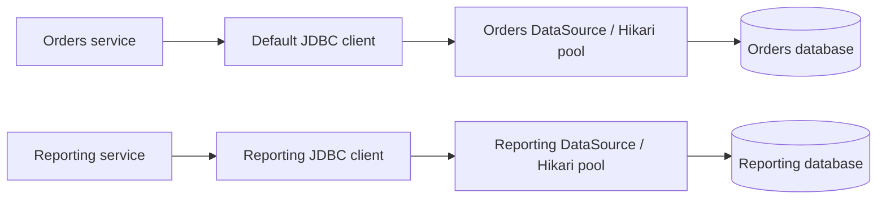

# Managing Multiple Data Sources in Spring Boot

A `DataSource` supplies database connections. Managing multiple data sources means deciding which connection provider each operation uses, which transaction manager controls it, and how each database is initialized and monitored.

**Documentation baseline:** checked on November 4, 2026 against the current Spring Boot reference, whose API links identify Spring Boot **4.1.2**. The Java examples use Boot 4 package names. Use the reference for your application's exact version rather than mixing examples from different releases.

## What Exactly Is a DataSource?

`javax.sql.DataSource` is a standard Java JDBC interface. Its central operation, `getConnection()`, returns a `java.sql.Connection` through which SQL can be executed.

Despite the name, a `DataSource` is **not the data itself**, a table, a database server, or a repository. It is an application-side connection provider, normally configured with a JDBC URL, credentials, and connection settings.

| Term | Responsibility |
| --- | --- |
| Database | Stores tables and data and executes SQL. |
| JDBC driver | Implements communication with a database product, such as PostgreSQL. |
| `DataSource` | Supplies connections to the application. |
| Connection pool | Reuses physical connections instead of opening a new one for every operation. |
| `JdbcTemplate` / `JdbcClient` | Executes SQL using a selected datasource and participates in Spring-managed JDBC transactions. |
| JPA `EntityManagerFactory` | Creates entity managers for a persistence unit, normally backed by one datasource. |
| Transaction manager | Coordinates commit and rollback for its configured resource or resources. |

The interface does not require pooling. **HikariCP** is the pool Boot normally chooses when it is on the classpath; the JDBC and JPA starters include it. A `HikariDataSource` is both a `DataSource` implementation and a connection pool.

When a pooled connection is closed, it normally returns to the pool rather than closing its physical database connection. Prefer Spring's data-access APIs for normal application work: they handle connection cleanup and transaction participation. Direct calls to `getConnection()` require careful resource handling and do not automatically reuse Spring's transaction-bound connection.

The `javax.sql` package is still correct in Boot 4. JDBC is part of Java SE; do not change this import to `jakarta.sql`. JPA entities, by contrast, use `jakarta.persistence`.



Two datasources can point to different databases, different servers, or even the same database with different credentials or pool settings. There is no mandatory one-to-one relationship between datasource beans and database servers.

This article concerns **JDBC SQL databases**. MongoDB and Redis use their own clients and factories; reactive SQL uses an R2DBC `ConnectionFactory`, not a JDBC `DataSource`.

## Do You Need More Than One?

| Requirement | Usual starting point |
| --- | --- |
| Several tables in one database | One datasource. Table count does not determine pool count. |
| Several accessible schemas using the same credentials and connection policy | Often one datasource, with explicit schema mappings or qualified SQL. |
| Orders database plus a separate reporting database | Two datasources with explicitly selected clients or repositories. |
| Same database, but separate least-privilege reporting credentials | Two datasources can provide separate credentials and pool budgets. |
| Read replicas or tenant-based database selection | Consider routing or provider-supported multi-tenancy, not just another unqualified bean. |
| Atomic writes to two independent databases | A distributed-transaction decision, not just datasource configuration. |

Do not add another pool solely to organize code. Each pool consumes connections and adds configuration, migration, transaction, and operational responsibilities.

## Recommended Starting Pattern

For a normal main database plus an additional database, the current Boot how-to recommends:

1. Keep the main datasource auto-configured through `spring.datasource.*`.
2. Define the additional datasource under an application-owned configuration prefix.
3. Mark the additional beans with `@Bean(defaultCandidate = false)` and select them using a qualifier.
4. Configure the additional data-access client and transaction manager explicitly.
5. Add separate JPA infrastructure only if you actually use JPA against that database.

**Why `defaultCandidate = false` matters:** an ordinary custom datasource bean can cause datasource auto-configuration to back off. Making the additional bean a non-default candidate lets Boot retain its default datasource. A qualifier still allows explicit injection of the additional bean.

`@Primary` solves a different problem: it gives one candidate preference when several beans match a single-valued injection. It does not create missing beans or make Boot initialize every database. If you deliberately configure *all* datasources yourself, choose a primary datasource and primary properties bean where infrastructure needs a default, then wire every resource explicitly. Do not mix that full-control pattern with the assumption that Boot will still create the main datasource.

The non-default-candidate pattern is available in Boot 3.4+ through Spring Framework 6.2+. In Boot 3.x, `DataSourceProperties` is in `org.springframework.boot.autoconfigure.jdbc`; in Boot 4 it is in `org.springframework.boot.jdbc.autoconfigure`. Older tutorials may require more than an import change.

## Example: Orders and Reporting With JDBC

Assume an existing Boot application with Java 17 or newer. Put the configuration classes below in its component-scan package or import them explicitly.

### 1. Add Dependencies

For PostgreSQL and JDBC, add these dependencies to an existing Maven project managed by the Boot parent or BOM:

```xml
<dependency>
    <groupId>org.springframework.boot</groupId>
    <artifactId>spring-boot-starter-jdbc</artifactId>
</dependency>
<dependency>
    <groupId>org.postgresql</groupId>
    <artifactId>postgresql</artifactId>
    <scope>runtime</scope>
</dependency>
```

Use the driver for each database product you access. Two PostgreSQL databases do not require two copies of the PostgreSQL driver. Let Boot manage compatible dependency versions.

### 2. Externalize Connection Settings

```yaml
spring:
  datasource:
    url: ${ORDERS_DB_URL}
    username: ${ORDERS_DB_USERNAME}
    password: ${ORDERS_DB_PASSWORD}
    hikari:
      pool-name: orders-pool
      maximum-pool-size: 10
      minimum-idle: 2
      connection-timeout: 3000

app:
  datasource:
    reporting:
      url: ${REPORTING_DB_URL}
      username: ${REPORTING_DB_USERNAME}
      password: ${REPORTING_DB_PASSWORD}
      configuration:
        pool-name: reporting-pool
        maximum-pool-size: 4
        minimum-idle: 1
        connection-timeout: 3000
```

Example URL values are `jdbc:postgresql://localhost:5432/orders` and `jdbc:postgresql://localhost:5432/reporting`. Supply credentials from your deployment environment or secret-management system, not committed configuration.

The pool sizes are illustrative, not recommended universal values. Hikari's `connection-timeout` is a wait-for-a-connection timeout in milliseconds, **not** a SQL query timeout. Set statement and transaction timeouts separately where required.

`spring.datasource.hikari.*` is Boot's built-in Hikari namespace. `app.datasource.reporting.configuration.*` is a custom namespace that works only because the next configuration binds it explicitly. Inventing `spring.datasource.reporting.*` alone does not make Boot create another datasource.

### 3. Create the Reporting Pool

```java
import com.zaxxer.hikari.HikariDataSource;

import org.springframework.beans.factory.annotation.Qualifier;
import org.springframework.boot.context.properties.ConfigurationProperties;
import org.springframework.boot.jdbc.autoconfigure.DataSourceProperties;
import org.springframework.context.annotation.Bean;
import org.springframework.context.annotation.Configuration;

@Configuration(proxyBeanMethods = false)
public class ReportingDataSourceConfiguration {

    @Bean(defaultCandidate = false)
    @Qualifier("reporting")
    @ConfigurationProperties("app.datasource.reporting")
    public DataSourceProperties reportingDataSourceProperties() {
        return new DataSourceProperties();
    }

    @Bean(defaultCandidate = false)
    @Qualifier("reporting")
    @ConfigurationProperties("app.datasource.reporting.configuration")
    public HikariDataSource reportingDataSource(
            @Qualifier("reporting") DataSourceProperties properties) {
        return properties.initializeDataSourceBuilder()
                .type(HikariDataSource.class)
                .build();
    }
}
```

The properties bean binds URL and credentials; the datasource bean binds pool-specific settings. `DataSourceProperties.initializeDataSourceBuilder()` translates the generic `url` setting into Hikari's `jdbcUrl` property. Binding directly to `HikariDataSource` without this properties layer requires `jdbc-url` instead of `url`.

There are now two connection providers: Boot's default orders datasource and the explicitly qualified reporting datasource. Do not construct pools per request or per repository; let Spring manage their lifecycle and close them on shutdown.

### 4. Select the Client and Transaction Manager

```java
import javax.sql.DataSource;

import org.springframework.beans.factory.annotation.Qualifier;
import org.springframework.context.annotation.Bean;
import org.springframework.context.annotation.Configuration;
import org.springframework.jdbc.core.simple.JdbcClient;
import org.springframework.jdbc.support.JdbcTransactionManager;

@Configuration(proxyBeanMethods = false)
public class ReportingJdbcConfiguration {

    @Bean(defaultCandidate = false)
    @Qualifier("reporting")
    public JdbcClient reportingJdbcClient(
            @Qualifier("reporting") DataSource dataSource) {
        return JdbcClient.create(dataSource);
    }

    @Bean(defaultCandidate = false)
    public JdbcTransactionManager reportingTransactionManager(
            @Qualifier("reporting") DataSource dataSource) {
        return new JdbcTransactionManager(dataSource);
    }
}
```

The additional client and transaction manager are non-default candidates too, so Boot can retain the corresponding default JDBC infrastructure. An unqualified `JdbcClient` uses orders; the reporting qualifier selects the additional client.

```java
import org.springframework.beans.factory.annotation.Qualifier;
import org.springframework.jdbc.core.simple.JdbcClient;
import org.springframework.stereotype.Service;
import org.springframework.transaction.annotation.Transactional;

@Service
public class ReportingService {
    private final JdbcClient jdbcClient;

    public ReportingService(@Qualifier("reporting") JdbcClient jdbcClient) {
        this.jdbcClient = jdbcClient;
    }

    @Transactional(transactionManager = "reportingTransactionManager", readOnly = true)
    public long countOrders() {
        return jdbcClient.sql("select count(*) from order_summary")
                .query(Long.class)
                .single();
    }
}
```

The reporting database must already contain `order_summary`, created through its own migration process. No replication or synchronization from orders is implied by this configuration.

The client qualifier selects the database; `transactionManager` selects the transaction boundary. **Neither automatically selects the other.** Invoke transactional methods through the Spring-managed service proxy; ordinary self-invocation bypasses proxy-based transaction interception.

`readOnly = true` is a transaction hint, not an authorization boundary or automatic replica routing. Use database permissions to enforce read-only access.

## What Changes If You Use JPA?

Use `spring-boot-starter-data-jpa` instead of the JDBC starter when you need JPA repositories and Hibernate; it brings JDBC support transitively. A datasource alone does not tell JPA which entities or repositories belong to which database.

For independent databases, the usual arrangement is:

```text
orders repositories -> orders EntityManagerFactory -> orders DataSource
                    -> orders JpaTransactionManager

reporting repositories -> reporting EntityManagerFactory -> reporting DataSource
                       -> reporting JpaTransactionManager
```

Keep the datasource configuration above, but **do not register `ReportingJdbcConfiguration`'s transaction manager** when replacing this path with JPA. Use a `JpaTransactionManager` for the reporting persistence unit instead. JDBC-only access to the second database does not require a second entity manager factory at all.

For a concrete Boot 4 setup, assume entities under `com.example.orders.entity` and `com.example.reporting.entity`, with repositories under their respective `.repository` packages. Substitute your actual packages. The following class retains Boot's default orders entity manager factory and adds an explicitly configured reporting factory:

```java
import java.util.Map;
import javax.sql.DataSource;
import jakarta.persistence.EntityManagerFactory;

import org.springframework.beans.factory.annotation.Qualifier;
import org.springframework.boot.persistence.autoconfigure.EntityScan;
import org.springframework.context.annotation.Bean;
import org.springframework.context.annotation.Configuration;
import org.springframework.data.jpa.repository.config.EnableJpaRepositories;
import org.springframework.orm.jpa.JpaTransactionManager;
import org.springframework.orm.jpa.LocalContainerEntityManagerFactoryBean;
import org.springframework.orm.jpa.vendor.HibernateJpaVendorAdapter;

@Configuration(proxyBeanMethods = false)
@EntityScan("com.example.orders.entity")
@EnableJpaRepositories(
        basePackages = "com.example.orders.repository",
        entityManagerFactoryRef = "entityManagerFactory",
        transactionManagerRef = "transactionManager")
public class PersistenceConfiguration {

    @Configuration(proxyBeanMethods = false)
    @EnableJpaRepositories(
            basePackages = "com.example.reporting.repository",
            entityManagerFactoryRef = "reportingEntityManagerFactory",
            transactionManagerRef = "reportingTransactionManager")
    static class ReportingPersistenceConfiguration {

        @Bean(defaultCandidate = false)
        public LocalContainerEntityManagerFactoryBean reportingEntityManagerFactory(
                @Qualifier("reporting") DataSource dataSource) {
            var factory = new LocalContainerEntityManagerFactoryBean();
            factory.setDataSource(dataSource);
            factory.setPackagesToScan("com.example.reporting.entity");
            factory.setPersistenceUnitName("reporting");
            factory.setJpaVendorAdapter(new HibernateJpaVendorAdapter());
            factory.setJpaPropertyMap(Map.of("hibernate.hbm2ddl.auto", "validate"));
            return factory;
        }

        @Bean(defaultCandidate = false)
        public JpaTransactionManager reportingTransactionManager(
                @Qualifier("reportingEntityManagerFactory") EntityManagerFactory factory) {
            return new JpaTransactionManager(factory);
        }
    }
}
```

This is deliberately a **manually configured reporting factory**. Boot's `spring.jpa.*` customizations do not automatically apply to it. Its example property map validates an already migrated schema; it does not create tables. Use explicit `@Table` / `@Column` mappings or configure the reporting naming strategy deliberately rather than assuming it inherits Boot's naming defaults.

For production configuration with many options, the official how-to demonstrates binding a separate `JpaProperties` bean and building an additional factory with an `EntityManagerFactoryBuilder`. Preserve or map the desired vendor settings explicitly. Reusing the auto-configured builder is useful when settings should be shared, but do not assume settings derived for one database vendor are correct for another.

For the auto-configured orders factory, a typical production policy is:

```yaml
spring:
  jpa:
    open-in-view: false
    hibernate:
      ddl-auto: validate
```

Disabling open-in-view keeps database access inside deliberate service boundaries; fetch the data needed by your response within those boundaries. The reporting factory's validation policy is configured independently above.

Keep repository scans non-overlapping and explicitly set both factory and transaction-manager references. For reporting service methods, use `@Transactional(transactionManager = "reportingTransactionManager")`. When injecting an entity manager directly, select the persistence unit with `@PersistenceContext(unitName = "reporting")`.

Do not map JPA entity relationships across independent persistence units. Carry identifiers or DTOs between them and coordinate at the service level.

## Transactions Do Not Automatically Span Databases

With two local transaction managers, a transaction on orders controls orders only. If the same service also writes to reporting, a reporting failure does not retroactively undo a committed orders transaction. Adding two managers, using `@Primary`, or nesting transactional service calls does not make the pair atomic.

Choose the guarantee intentionally:

| Required guarantee | Approach |
| --- | --- |
| Operations concern only one database | Use that database's local transaction manager. |
| Orders must eventually update reporting | Consider an outbox written in the orders transaction, then asynchronous delivery with retries and idempotent consumers. |
| A multi-step business workflow can compensate | Consider a saga with explicit compensation and recovery rules. |
| Both databases must commit atomically | Evaluate JTA/XA with compatible databases, XA resources, a coordinator, and recovery operations. |

An ordinary Hikari pool plus local transaction managers is not an XA setup. Outbox and saga designs provide different guarantees from atomic distributed commit; do not describe them as interchangeable.

## Schema Migrations and Initialization

Use one schema-management mechanism per database, normally Flyway or Liquibase. Avoid production schema evolution through Hibernate `ddl-auto=update`; use reviewed, versioned migrations and optionally validate entity mappings afterward.

Boot's default migration setup targets its selected default datasource. It does **not** automatically run an independent migration history for every datasource bean.

- `@FlywayDataSource` or `@LiquibaseDataSource` selects a datasource for the auto-configured migration tool. It does not mean "migrate every datasource".
- To migrate both databases, configure separate migration instances and histories, or run distinct migration jobs in the deployment pipeline. Use separate script locations or changelogs for each database.
- If you define migration beans yourself, check which migration auto-configurations back off. Ensure both intended migrations still run, and finish before the corresponding entity manager factory validates or uses its schema.
- Use separate migration credentials when DDL privileges should not belong to the runtime application user.
- For Boot 4 Flyway integration, use `spring-boot-starter-flyway` and the database-specific module where required, such as `org.flywaydb:flyway-database-postgresql`. Liquibase integration uses `spring-boot-starter-liquibase`.

Do not combine basic `schema.sql` / `data.sql` initialization with Flyway or Liquibase as competing schema owners. See [JPA ID Generation and Hibernate Schema Management](../java/persistence/jpa-id-generation-and-hibernate-schema-management.md) for the distinction between ID generation and schema creation.

## Operational Best Practices

- **Budget connections per database server.** Count every application replica, pool, background worker, migration job, and parallel test context that connects to that server. If both pools target one server, both count against its limit.
- **Size pools from measurements.** Larger pools can increase contention rather than throughput. Keep minimum idle, maximum size, wait timeouts, query timeouts, and connection lifetime consistent with workload and infrastructure limits.
- **Name and monitor pools separately.** With Actuator and the relevant metrics registry, observe active, idle, maximum, and pending connections, acquisition latency, and timeouts. Verify both custom and default pools are visible.
- **Separate health from routing policy.** Decide whether a reporting outage should make the whole service unready. Configure health groups deliberately; changing readiness does not itself make reporting calls tolerate failures.
- **Apply least privilege and transport security.** Use separate database users where appropriate, configure TLS according to the driver and deployment, and avoid logging credentials or sensitive SQL parameters.
- **Treat routing as a separate design.** If using `AbstractRoutingDataSource`, choose the route before the transaction acquires a connection, clean up routing context, and handle asynchronous execution explicitly. `readOnly = true` alone does not route queries.

For example, four application replicas with a maximum of ten connections each can demand forty connections from the orders server. A separate reporting server needs its own calculation; if both pools share a server, add their budgets together.

See [Database Connection Exhaustion in Tests](testing/database-connection-exhaustion.md) for how cached contexts and multiple pools multiply test connections.

## What to Test Before Shipping

1. Start the application with both databases available and verify that both datasource beans exist, including Boot's default one.
2. Seed distinguishable data and prove that the default client reads orders while the reporting client reads reporting. A successful connection alone does not prove correct routing.
3. For JPA, verify each repository uses its intended factory and that entity scans do not leak across persistence units.
4. Cause a failure within each local transaction and verify rollback in the corresponding database. Test cross-database partial failures against your documented recovery strategy.
5. Run migrations from an empty database and upgrade an existing schema for each database independently.
6. Exercise an unavailable reporting database, pool exhaustion, and timeouts; verify expected startup, readiness, and request behavior.
7. Prefer integration tests against the actual database engines, commonly through Testcontainers, instead of assuming H2 reproduces production SQL behavior.

These are checks to implement in the consuming application, not claims that the snippets have been integration-tested here. For container lifecycle guidance, see [Shared PostgreSQL Testcontainers](testing/shared-postgres-testcontainers.md).

## Bottom Line

Start with **one auto-configured main datasource and one explicitly qualified additional datasource**. Add one client and local transaction manager per JDBC path, or one persistence unit, repository group, and JPA transaction manager per independent JPA database. Then explicitly own migrations, connection budgets, and cross-database failure handling.

## Official References

- [Spring Boot: Configure Two DataSources](https://docs.spring.io/spring-boot/how-to/data-access.html#howto.data-access.configure-two-datasources)
- [Spring Boot: SQL Databases](https://docs.spring.io/spring-boot/reference/data/sql.html)
- [Spring Boot: Using Multiple EntityManagerFactories](https://docs.spring.io/spring-boot/how-to/data-access.html#howto.data-access.use-multiple-entity-managers)
- [Spring Boot: Database Initialization](https://docs.spring.io/spring-boot/how-to/data-initialization.html)
- [Spring Boot: Distributed Transactions With JTA](https://docs.spring.io/spring-boot/reference/io/jta.html)
- [Java: DataSource API](https://docs.oracle.com/en/java/javase/17/docs/api/java.sql/javax/sql/DataSource.html)
- [Spring Framework: Declarative Transaction Management](https://docs.spring.io/spring-framework/reference/data-access/transaction/declarative.html)

The unversioned Boot links follow the current documentation over time. When applying the examples, select the documentation version matching your Boot release.